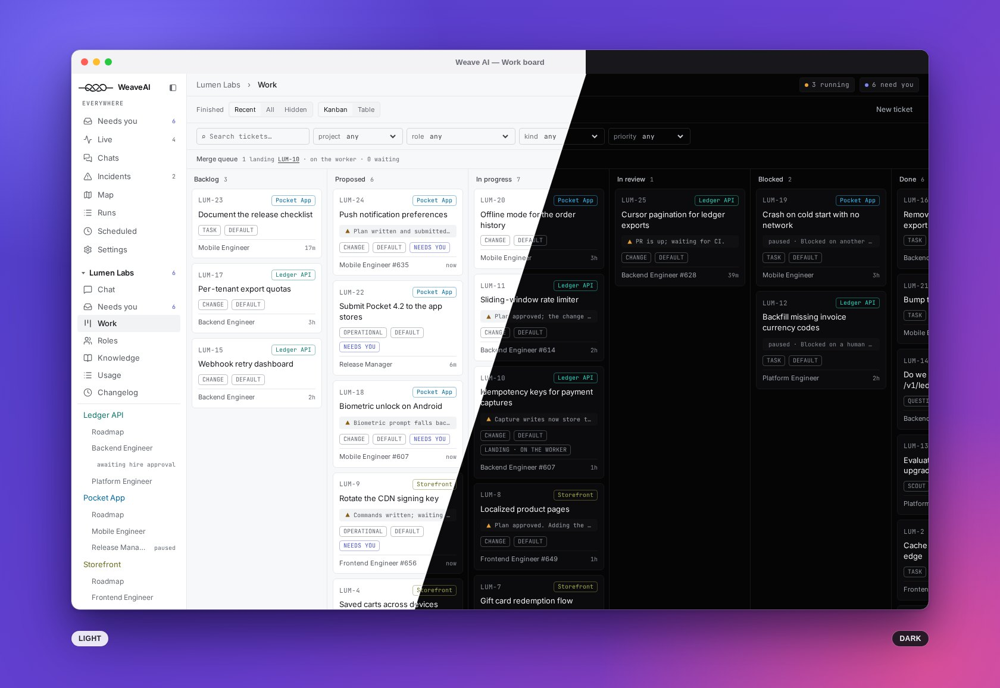
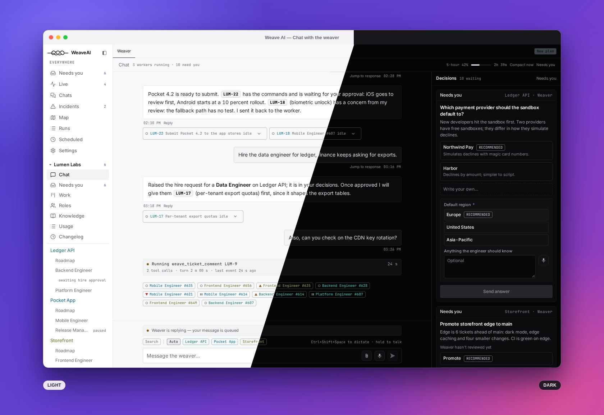
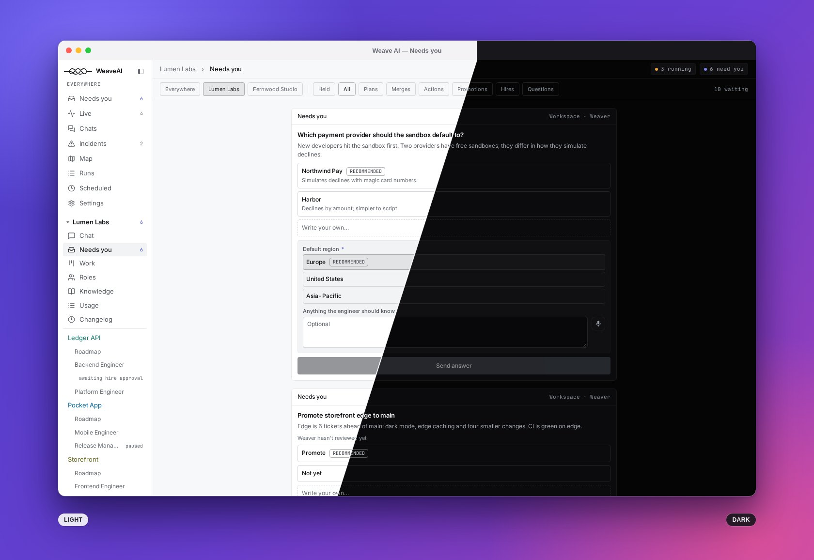
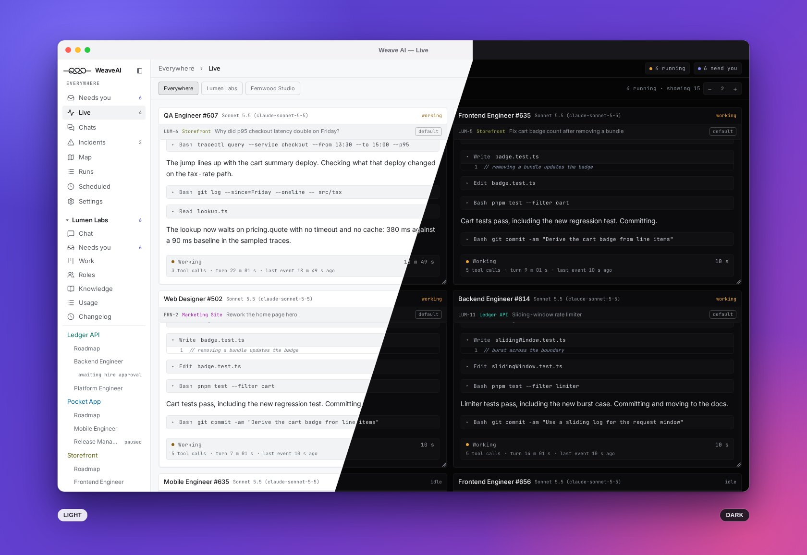
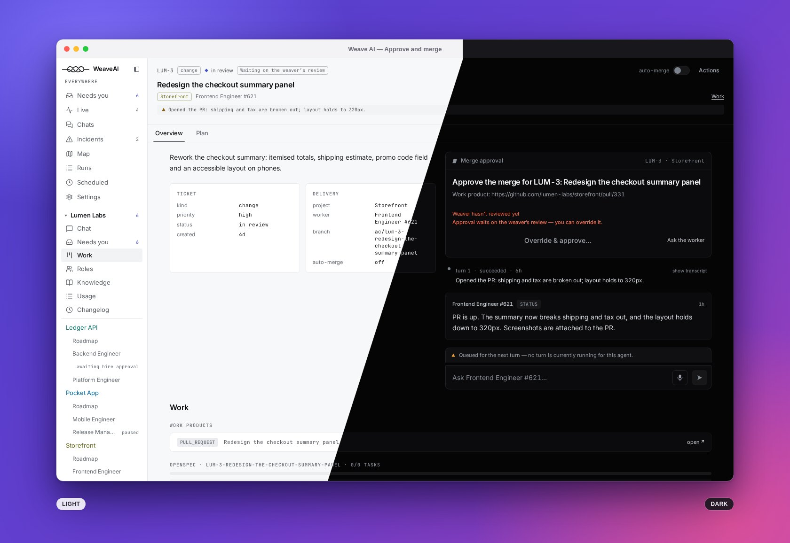
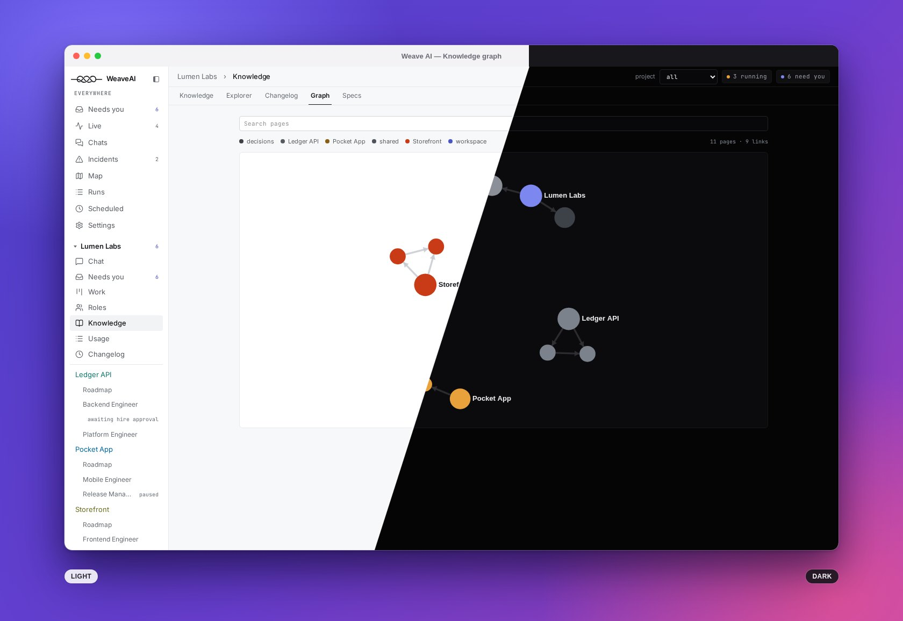
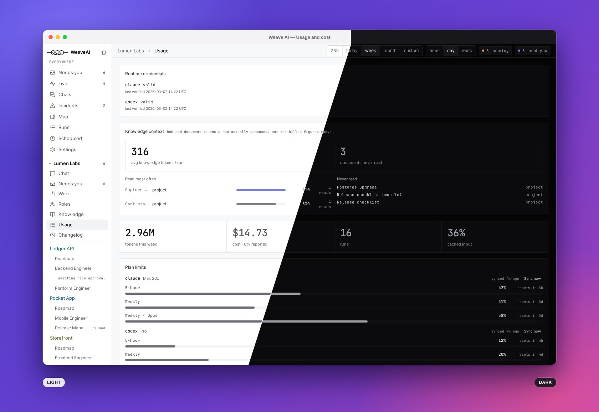
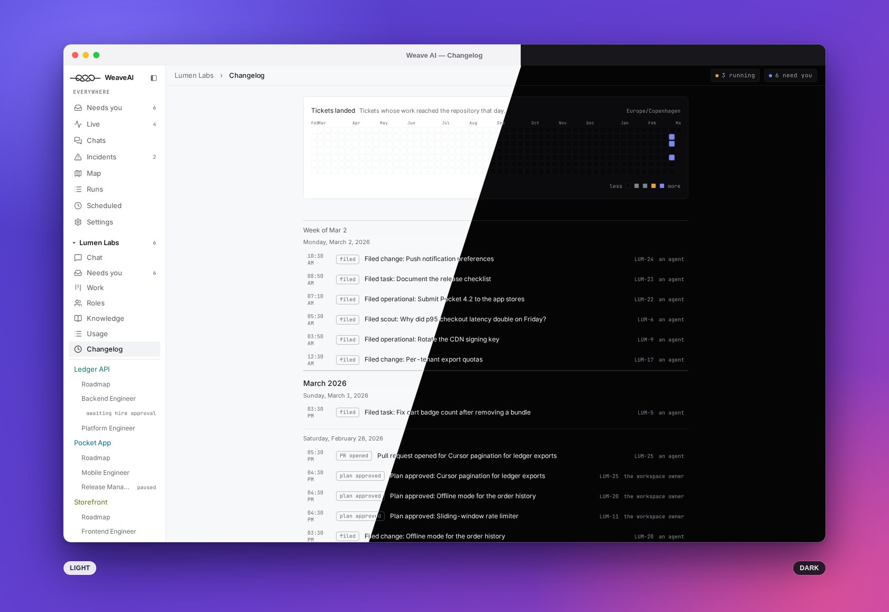

<div align="center">

# Weave AI

**A team of AI agents for your codebase. You talk to one of them; the rest do the work, and you approve what lands.**

</div>

<p align="center">
  
</p>

You say *"add dark mode to the dashboard."* The **weaver**, the one agent you talk to, turns that into
a ticket and hires a role for the project if none fits. A disposable **worker** picks the ticket up in
its own git worktree, proposes a plan, waits for your approval, implements it, opens a pull request,
and merges it once you approve. You never manage the mechanics: state transitions, worktrees, locks,
git operations, spec state and cost accounting are all code. Only judgment is left to agents.

- **You stay in charge.** Plans, hires and merges are explicit approvals. A worker never merges
  without yours unless you turned auto-merge on for that ticket (it is off by default).
- **It runs without you.** The daemon is a server. Close your laptop mid-ticket and the workers keep
  going on the daemon host. Work from the web app (an installable PWA), the `weave` CLI, or Telegram.
- **Bring your own coding CLI.** Workers run on Claude Code, OpenCode, Codex, Gemini CLI or Cursor, whichever
  you chose, and never cross the project boundary: a worker in project A cannot learn that project B
  exists.
- **Every change leaves a spec behind.** Change tickets follow OpenSpec's propose, approve, apply,
  archive flow.
- **Cost stays flat.** Familiarity with a project lives in a budgeted, curated knowledge base, not in a
  growing chat, so the bootstrap cost per worker does not climb over the life of the workspace.
- **Private by default.** Remote access is password-gated and encrypted. The only unauthenticated mode
  is an explicit loopback-only setting for local development. AGPL-3.0, and nothing phones home.

*(Every screenshot here is the built-in demo mode: a made-up company called Lumen Labs. Each shows the
same page in light mode on the left and dark mode on the right.)*

## Ask for something, and see what needs you

Talk to the weaver in plain language. It answers with what is in flight, files tickets, and raises the
decisions that are yours to make. Everything waiting on you is in one place, with the weaver's own
review of it beside each card.

<p align="center">
  
</p>

<p align="center">
  
</p>

## Watch the work happen

Workers are visible while they run: what each is reading, editing and testing, live, and you can steer
one by commenting on its ticket.

<p align="center">
  
</p>

<p align="center">
  
</p>

## Approve the plan, then review the result

A change ticket starts as a plan. The worker writes it, the weaver reviews it, and you approve, ask for a
revision, or reject, from the web app, the terminal or Telegram. When the work is done it arrives as a
pull request with the worker's summary and the weaver's review. Approve the merge and the daemon lands it:
it waits for CI on the exact head, merges with the project's merge method, and archives the OpenSpec change.

<p align="center">
  
</p>

## Plan the larger picture

<p align="center">
  
</p>

## A knowledge base that keeps agents oriented

Each project has a curated, budgeted knowledge base that its workers read at the start of every turn.
Pages link to each other, and you can browse them as a graph.

<p align="center">
  
</p>

## Know what it costs

Tokens and cost by model, role, ticket and worker, plus your coding-CLI plan limits.

<p align="center">
  
</p>

## See the whole workspace

<p align="center">
  
</p>

<p align="center">
  
</p>

---

## How it works

| Concept | What it is | Lives in |
|---|---|---|
| **Workspace** | A directory + SQLite DB representing one virtual business. One daemon hosts many. | `<dir>/workspace.yaml`, `<dir>/.weave/db.sqlite` |
| **Project** | A git repo cloned into the workspace. Has a default runtime, branch, policies, OpenSpec root. | `<ws>/projects/<id>/` (reference clone, never a cwd) |
| **Weaver** | The one workspace-scoped agent you talk to. Creates tickets, hires roles, assigns, supervises, reports. Read-only on projects. | `<ws>/conductor/` |
| **Role** | A hired template scoped to one project: charter, concurrency limit. Roles do not run. | `<ws>/roles/<id>/role.yaml`, `CHARTER.md` |
| **Worker** | A disposable agent spawned from a role for exactly **one ticket**, with its own home, brief, worktree and session for the ticket's life. Retired once the work lands. | `<ws>/workers/<id>/`, worktree at `work/` |
| **Ticket** | The unit of work: `change`, `task`, `scout` or `question`. Identifier `ACME-42`. | DB, mirrored to `<ws>/tickets/` |
| **Decision** | Anything held for a human (or the weaver): plan approval, hire approval, merge approval, a worker's question, a discard confirmation. | DB, `weave decision`, UI, Telegram buttons |
| **Knowledge base** | Curated, budgeted markdown: the workspace KB (weaver-only), `SHARED.md` (every agent), one `PROJECT.md` per project (that project's workers only). | `<ws>/knowledge/` |
| **Specs** | OpenSpec capabilities and changes per project, indexed and browsable. Specs change only through tickets. | the project repo's `openspec/`, indexed into the DB |
| **Run / wakeup** | One executed agent turn; a durable request to run one. Agents are wake-driven, never polling. | DB, `<ws>/.weave/runs/<runId>/` |
| **Surface** | Where an agent is *shown*: headless, tmux, herdr, Hyprland. Never changes how a run executes. | `presentation:` in `workspace.yaml`, reconciled by `weave presenter` |

Ticket statuses: `backlog → todo → proposing → proposed → approved → in_progress → in_review →
merging → done`, plus `blocked` and `cancelled`.

Three rules worth internalising:

1. **The project boundary is absolute.** A worker's write scope is its own worktree and its own
   ticket. Cross-project work is coordinated through tickets, never shared files.
2. **Evidence is not authorization.** A scout report never authorizes a code change; approval gates
   are explicit state.
3. **A worker never merges without human approval** unless the ticket has `autoMerge` on (off by
   default; the weaver never turns it on by itself).

## Requirements

| | |
|---|---|
| Node | **≥ 22** (the DB uses `node:sqlite`). The repo pins Node 26 via `mise.toml`. |
| pnpm | 11.x (`mise` installs it; `corepack` works too) |
| git | required |
| A coding CLI | at least one of `claude`, `opencode`, `codex`, `gemini`, `cursor-agent`, **logged in on the daemon host** |
| `gh` | required for `deliveryMode: pr` (the default). Use `deliveryMode: local-branch` without it. |
| `openspec` | optional, recommended: `npm i -g @fission-ai/openspec`. Without it `change` tickets skip spec artifacts and the Spec Explorer is empty. |
| `worktrunk` (`wt`) | optional, recommended: `cargo install worktrunk` / `brew install worktrunk` / `pacman -S worktrunk`. Without it the built-in `git worktree` fallback is used automatically. |

Nothing is installed for you by default. `weave doctor` reports what is missing on this machine and on
the daemon host; `weave doctor --install` offers to install the missing pieces that need no root and
prints the `sudo` command for the rest.

## Install

```bash
git clone git@github.com:victornor/agent-conductor.git && cd agent-conductor
mise install                 # node + pnpm, if you use mise
pnpm install
pnpm build                   # tsc -b across every package, and the web app
```

Once the daemon runs from a release, `weave daemon install-service` (and every `weave daemon upgrade`)
writes `~/.local/bin/weave` for you, pointing at the current release. Before that first install, from
a source checkout, put `weave` on your PATH either by linking the package or with a two-line wrapper
(the wrapper is what survives a `mise` node upgrade and works from systemd):

```bash
cd packages/cli && pnpm link --global          # option 1
# option 2
cat > ~/.local/bin/weave <<EOF
#!/bin/sh
exec "$(mise which node)" "$PWD/packages/cli/dist/bin.js" "\$@"
EOF
chmod +x ~/.local/bin/weave
```

The pre-rename `conductor` command still works as a deprecated alias; it will be removed later.
Where `weave` is not on your PATH, substitute `node packages/cli/dist/bin.js`.

```bash
weave doctor              # node, git, gh, openspec, worktrunk, runtimes, daemon, password, workspaces
weave doctor --install    # offers the missing no-root installs; prints the sudo ones
```

`weave doctor` is the checklist for everything below: whenever a step fails, run it first. A container
image is also available: see [`docs/DOCKER.md`](docs/DOCKER.md).

## Quickstart

One machine, local development. (A daemon on a server, worked from a laptop and a phone, is in
[`docs/REMOTE-SETUP.md`](docs/REMOTE-SETUP.md).)

```bash
# 1. Trust loopback so you can skip the password while developing.
mkdir -p ~/.config/weave
cat > ~/.config/weave/daemon.yaml <<'YAML'
version: 1
http:
  listen: 127.0.0.1:7433
auth:
  loopbackTrusted: true
YAML

# 2. Start the daemon and check the machine.
weave daemon start
weave doctor                      # green, or exactly what is missing

# 3. Create a workspace. It is scaffolded on the daemon host and registered.
weave init ~/Work/acme --prefix ACME --name "Acme Labs"

# 4. Make sure a coding CLI is available and authenticated.
weave runtime list
weave runtime login claude        # only if the inherited credentials are not enough

# 5. Add a project. Clones it, runs `openspec init`, seeds the project KB,
#    and creates a scout ticket that describes the repo.
weave project add git@github.com:acme/api.git --runtime claude

# 6. Talk to the weaver.
weave say "what is in this workspace?"
weave chat                        # interactive
```

Open <http://127.0.0.1:7433> for the web app. If it shows "the web UI has not been built", run
`pnpm --filter @weave-ai/ui build` and reload.

### Try it without agents

`weave demo` starts a complete daemon on made-up data (no coding CLI, git remote, forge or network),
listening on a free loopback port. It is how the screenshots above are made.

```bash
weave demo        # from a built checkout; Ctrl-C stops it
```

See [`docs/demo-mode.md`](docs/demo-mode.md).

## Documentation

| | |
|---|---|
| [`docs/CLI.md`](docs/CLI.md) | the command cheat-sheet: daemon, workspaces, tickets, roles, workers, usage, knowledge |
| [`docs/CONFIGURATION.md`](docs/CONFIGURATION.md) | `daemon.yaml`, `workspace.yaml`, roles, credentials, runtime status, plugins |
| [`docs/REMOTE-SETUP.md`](docs/REMOTE-SETUP.md) | a daemon on a server: Tailscale, TLS, laptop and phone, Telegram |
| [`docs/OPERATIONS.md`](docs/OPERATIONS.md) | running a daemon on a server: systemd, TLS, backups, upgrades, troubleshooting |
| [`docs/DOCKER.md`](docs/DOCKER.md) | the container image: one `/data` volume |
| [`docs/PLUGINS.md`](docs/PLUGINS.md) | writing a plugin: runtimes, channels, tools, pages |
| [`docs/API.md`](docs/API.md) | the HTTP + SSE + MCP control-plane API |
| [`docs/PLAN.md`](docs/PLAN.md) | the implementation plan: decisions, domain model, interfaces |
| [`docs/SCENARIOS.md`](docs/SCENARIOS.md) | end-to-end walkthroughs of what each participant sees |
| [`docs/demo-mode.md`](docs/demo-mode.md) | demo mode, and how these screenshots are regenerated |
| [`skills/README.md`](skills/README.md) | the agent-facing instruction layer |
| [`CLAUDE.md`](CLAUDE.md) | conventions for coding agents working on this repo |

Root scripts: `pnpm build`, `pnpm test`, `pnpm lint` (the boundary and console guards),
`pnpm typecheck`, `pnpm dev` (daemon in the foreground). CI runs the same checks on a self-hosted
GitHub Actions runner; see [`docs/OPERATIONS.md` §9](docs/OPERATIONS.md#9-self-hosted-ci-runner).

## Licence and contributing

Weave AI is licensed under the **GNU Affero General Public License v3.0** ([`LICENSE`](LICENSE)).
Paid features live in [`ee/`](ee/) under a separate commercial licence ([`ee/LICENSE`](ee/LICENSE)):
free to read, build, modify and test, but production use needs a licence key.

Contributions are welcome. By submitting one you accept the contributor licence agreement in
[`CLA.md`](CLA.md), which lets the project relicense your work, including into `ee/`. Read
[`CLAUDE.md`](CLAUDE.md) for the repo's conventions before you open a pull request.
